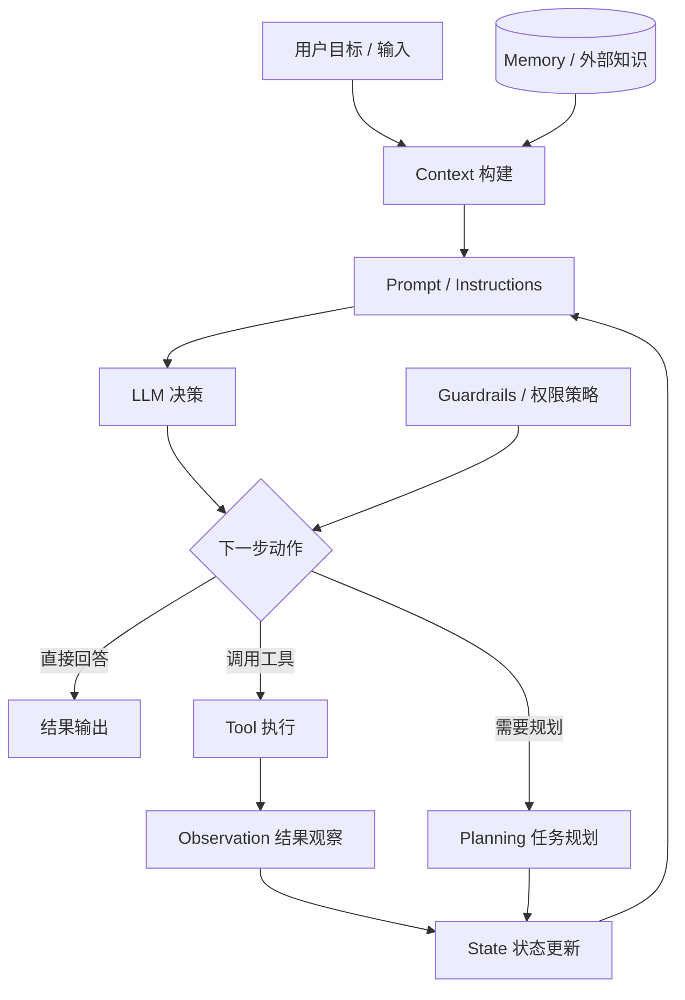
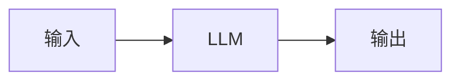
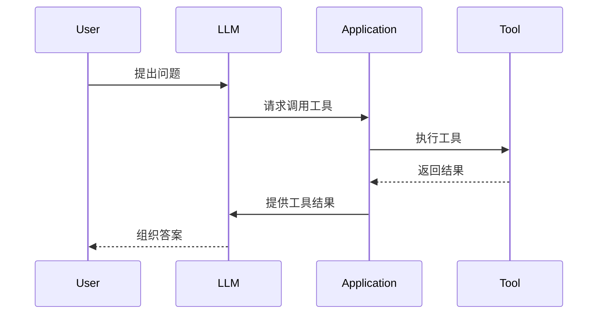
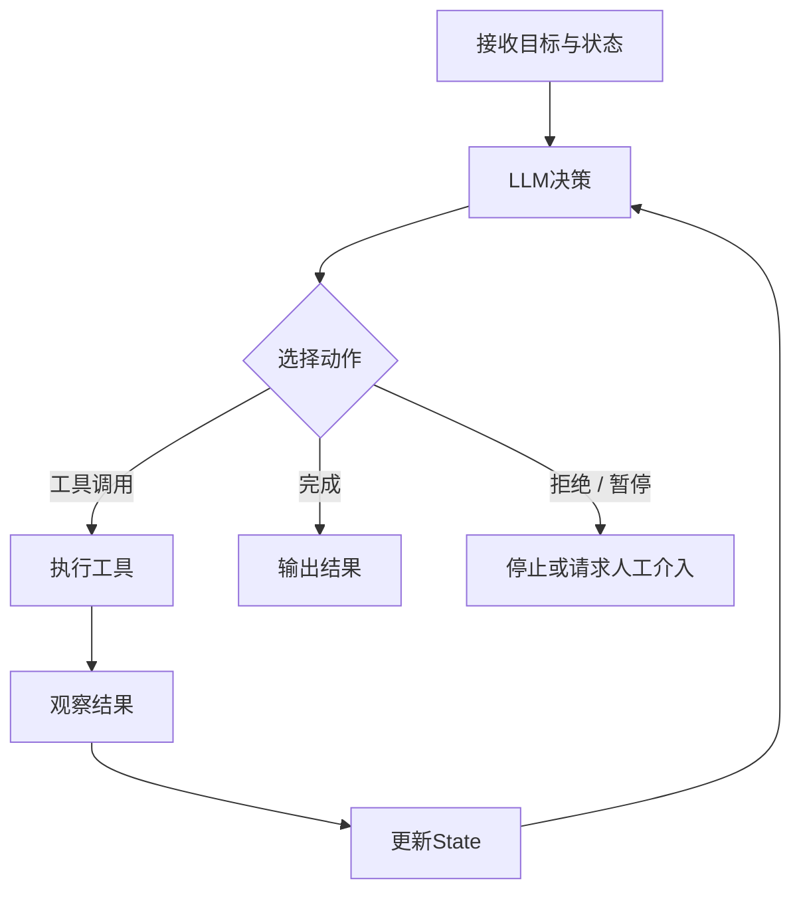
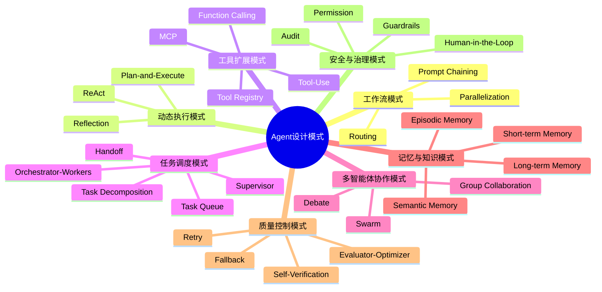
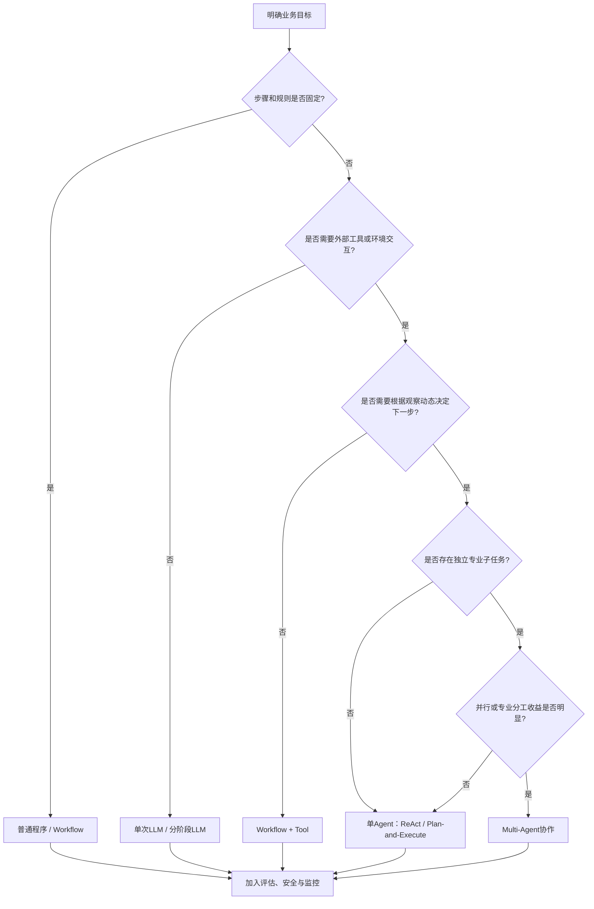

# 第1章 Agent设计模式基础

> 本章目标：建立 Agent 系统的基本概念，理解 Agent 的组成、执行机制、模式分类与选型原则，为后续模式学习和 AI 软件开发 Agent 综合实战打基础。

## 1.1 Agent设计模式定义

### 1.1.1 什么是 AI Agent

AI Agent（人工智能智能体）是一类能够围绕目标感知输入、选择行动、调用工具、观察结果，并根据运行状态继续推进任务的软件系统。它通常以大语言模型（LLM）作为推理与决策核心，但并不等同于一次 LLM 对话。

一个实用的 Agent 系统通常包含：

- **目标（Goal）**：系统需要完成的任务或达到的状态。
- **模型（Model）**：理解任务、生成计划、选择行动或形成结果。
- **指令（Instructions）**：定义角色、目标、边界和行为规范。
- **工具（Tools）**：让模型能够查询数据、调用 API、执行代码或操作外部系统。
- **状态（State）**：记录任务进度、当前输入、工具结果和中间产物。
- **控制逻辑（Control Flow）**：决定下一步执行什么、是否继续、何时结束。
- **反馈（Feedback）**：通过观察工具结果或环境变化修正后续行动。

因此，Agent 的关键不是“用了大模型”，而是系统是否具备围绕目标进行行动选择、结果观察和流程推进的能力。

### 1.1.2 什么是 Agent 设计模式

Agent 设计模式（Agent Design Patterns）是针对 Agent 系统中反复出现的设计问题，总结出来的可复用解决方案。它描述某类问题的上下文、核心结构、协作角色、执行流程、适用条件和代价。

例如：

| 设计问题 | 常见模式 | 核心思路 |
|---|---|---|
| 一个任务需要分阶段处理 | Prompt Chaining | 将步骤串联，前一步输出成为后一步输入 |
| 不同请求需要不同处理方式 | Routing | 先分类，再交给对应流程或处理器 |
| 多个相互独立的子任务 | Parallelization | 并行执行，再汇总结果 |
| 需要边判断边调用工具 | ReAct | 思考、行动、观察，循环推进 |
| 复杂目标需要先制定计划 | Plan-and-Execute | 先规划，再逐项执行和调整 |
| 需要多个专业角色协作 | Supervisor / Orchestrator-Workers | 由协调者分配和汇总子任务 |
| 结果需要达到明确质量标准 | Evaluator-Optimizer | 生成、评估、反馈、迭代 |
| 高风险动作需要人确认 | Human-in-the-Loop | 在关键节点暂停并等待人工审批 |

设计模式不是某个框架的专属 API，也不是要求所有 Agent 都必须使用的固定架构。它更像一套架构词汇，帮助团队描述问题、比较方案并形成可维护的系统。

### 1.1.3 Agent设计模式与传统软件设计模式

传统软件设计模式主要处理对象协作、模块解耦、创建方式和行为组织等问题，例如工厂模式、策略模式、观察者模式。Agent 设计模式更多处理模型参与决策后出现的问题，例如任务规划、工具选择、上下文管理、动态控制、协作与质量评估。

两者并不冲突。实际工程中通常需要同时使用：

- 用**策略模式**封装不同模型或不同 Agent 的选择策略。
- 用**工厂模式**创建不同类型的工具或 Agent。
- 用**观察者模式**发布任务状态、执行日志和评估事件。
- 用**状态模式**管理任务状态流转。
- 用 Agent 设计模式组织 LLM、工具、状态与控制流程。

可以把传统设计模式理解为软件结构组织方法，把 Agent 设计模式理解为面向模型驱动任务执行的系统组织方法。实际项目往往是两类模式的组合。

### 1.1.4 Agent设计模式与 Workflow 的区别

Workflow（工作流）是按照预先定义的步骤和控制逻辑执行任务的流程。每一步通常有明确输入、输出和执行条件。Agent 则允许模型在执行过程中根据上下文和观察结果决定下一步行动。

| 维度 | Workflow | Agent |
|---|---|---|
| 流程控制 | 主要由开发者预先定义 | 部分控制权交给模型动态决策 |
| 执行路径 | 相对固定、可预测 | 可根据中间结果变化 |
| 步骤选择 | 规则或固定流程 | 模型判断、规划或路由 |
| 工具调用 | 通常由流程节点指定 | 可由模型根据需要选择工具 |
| 可控性 | 通常较高 | 需要额外约束和评估 |
| 可解释性 | 流程路径较容易追踪 | 需要记录决策、状态和工具轨迹 |
| 适合场景 | 稳定、重复、规则明确的业务 | 需求开放、步骤不完全确定的任务 |
| 主要风险 | 流程变更需要修改编排 | 非确定性、循环、成本和错误行动 |

需要避免一个常见误区：Workflow 不代表“低级”，Agent 也不代表“更先进”。如果任务步骤清楚、规则稳定，优先使用 Workflow 往往更便宜、更可靠、更容易测试。只有当任务确实需要动态判断或行动选择时，才有必要引入 Agent。

很多生产系统采用混合方式：外层 Workflow 负责确定性流程、权限和边界；其中某些节点使用 Agent 处理需要判断的子任务。

### 1.1.5 Agent设计模式与 Multi-Agent 架构的区别

Multi-Agent（多智能体）是由多个 Agent 组成的协作系统。它是一种系统组织方式，不是所有 Agent 设计模式的同义词。

- **单 Agent**：一个 Agent 在限定工具和状态中完成任务。
- **Multi-Agent**：多个具有不同职责、上下文或工具权限的 Agent 协作完成任务。
- **Agent 设计模式**：既包括单 Agent 内部的执行模式，也包括多 Agent 之间的协调模式。

例如 ReAct 可以用于单 Agent；Supervisor、Swarm 或 Debate 则通常涉及多个 Agent 或多个角色。不要为了“看起来智能”而拆分 Agent。多 Agent 会引入通信、状态同步、调度、错误传播和额外模型调用成本。

### 1.1.6 Agent设计模式的价值

1. **降低架构设计难度**：把复杂问题映射到已知模式。
2. **提高复用性**：相似任务可以复用执行结构，而不是每次重新设计。
3. **明确职责边界**：模型、工具、状态、流程和人工审批各司其职。
4. **改善可测试性**：可以针对路由、工具、状态迁移和评估节点分别测试。
5. **控制复杂度与成本**：帮助判断何时使用固定流程、单 Agent 或 Multi-Agent。
6. **便于团队沟通**：用统一术语讨论架构、风险和改进方案。

---

## 1.2 Agent基本组成

### 1.2.1 核心组件总览

一个典型 Agent 可以抽象为以下结构：

上图是概念模型，不意味着每个实现都必须把所有模块拆成独立服务或节点。简单任务可以把多个职责放在一个函数中；复杂系统再逐步拆分。

### 1.2.2 LLM：推理与决策核心

LLM 负责理解自然语言、提取信息、生成结构化结果、提出计划或选择工具。它的输出具有概率性，可能出现事实错误、参数错误、遗漏约束或不符合格式等问题。

工程上不能把 LLM 的自然语言输出直接当作可信指令执行。关键决策应结合结构化输出、参数校验、权限检查、业务规则和执行结果验证。

### 1.2.3 Prompt / Instructions：行为约束

Prompt 或 Instructions 用于说明：

- Agent 扮演什么角色。
- 要完成什么目标。
- 可以使用哪些工具。
- 哪些行为被允许或禁止。
- 结果需要采用什么格式。
- 遇到不确定情况如何处理。

Prompt 是行为引导，不是安全边界。涉及文件删除、资金操作、发布代码等高风险动作时，必须在工具层实施权限与审批控制，不能只依赖提示词。

### 1.2.4 Tool：连接外部世界

Tool 是 Agent 可调用的外部能力，例如：

- 搜索文档或知识库。
- 查询数据库。
- 调用业务 API。
- 读取或写入文件。
- 执行测试命令。
- 创建工单或提交代码。

工具需要明确名称、用途、参数结构、返回结构、权限范围、超时和错误语义。工具调用是 Agent 从“生成内容”走向“执行任务”的关键能力，但也扩大了系统风险面。

### 1.2.5 Memory：记忆与知识

Memory 用于保存或检索对后续任务有价值的信息。常见形态包括：

- 当前会话上下文。
- 当前任务的中间状态。
- 历史任务记录。
- 用户偏好或长期事实。
- 外部知识库与检索结果。

Memory 不等于把所有聊天记录无限塞进 Prompt。系统需要考虑写入条件、检索策略、时效性、隐私、冲突解决和遗忘机制。第7章会专门展开。

### 1.2.6 Planning：任务规划

Planning 是把目标转化为可执行步骤的过程。计划可以是固定模板，也可以由模型动态生成。计划通常包含子任务、依赖关系、完成标准和失败处理策略。

简单任务不一定需要独立规划模块。过度规划会增加延迟和 Token 消耗，也可能产生不必要的复杂度。

### 1.2.7 Execution：行动执行

Execution 负责真正执行模型选择的动作，例如调用工具、运行函数、访问 API 或推进工作流节点。执行层需要处理参数解析、权限校验、超时、异常、重试和结果标准化。

### 1.2.8 Observation：观察执行结果

Observation 是对工具返回值或环境变化的读取与解释。Agent 不应只根据“自己打算做什么”判断任务完成，而应根据实际执行结果决定下一步。

例如代码开发 Agent 不能因为生成了代码就认定任务完成，还应运行测试、读取错误输出并检查验收条件。

### 1.2.9 State：运行状态

State 是任务执行过程中的结构化状态。典型字段包括：

- task_id：任务标识。
- user_request：原始需求。
- plan：任务计划。
- current_step：当前步骤。
- messages：对话与工具消息。
- tool_results：工具执行结果。
- status：任务状态。
- errors：错误记录。
- final_output：最终结果。

State 与 Memory 的区别：State 更偏向当前运行实例的工作状态；Memory 更偏向跨步骤、跨会话或跨任务可复用的信息。二者可能使用同一种存储技术，但语义和生命周期不同。

---

## 1.3 Agent基本执行机制

### 1.3.1 单次 LLM 调用

流程：输入上下文 → LLM → 输出。

适合摘要、改写、分类、信息抽取等一次生成即可完成的任务。它通常不是完整的 Agent 循环，因为模型没有基于工具观察持续行动。

### 1.3.2 LLM + Tool

流程：输入 → LLM 选择或生成工具调用 → 程序执行工具 → 返回结果 → LLM 组织回答。

这已经具备工具增强能力，但是否属于 Agent，要看系统是否允许模型根据观察结果继续选择下一步行动，而不是只执行一次预定调用。

### 1.3.3 Agent Loop

Agent Loop 是动态 Agent 的典型执行机制：

1. 接收目标和当前状态。
2. 模型分析当前信息并决定行动。
3. 如果需要工具，则发起工具调用。
4. 执行层运行工具并返回观察结果。
5. 更新状态。
6. 模型根据新状态继续决策。
7. 达到完成条件、预算上限或安全停止条件后结束。

Agent Loop 必须设计停止条件，例如最大迭代次数、时间预算、Token 预算、任务完成判定、连续失败次数和人工中止信号。没有停止条件的循环可能造成成本失控。

### 1.3.4 Workflow

Workflow 通过预定义节点和边控制执行。节点可以是普通函数、LLM 调用或 Agent 子流程。它适合可预测的业务链路，也便于对每个节点进行测试和监控。

### 1.3.5 Multi-Agent

Multi-Agent 把任务分配给多个角色或专业 Agent，通过消息、共享状态或任务交接完成协作。它适合职责可分、并行收益明显、专业上下文差异较大的任务。若任务本身很简单，多个 Agent 往往只会增加成本和失败点。

### 1.3.6 五种执行机制对比

| 机制 | 决策是否动态 | 是否使用工具 | 是否循环 | 典型场景 |
|---|---|---|---|---|
| 单次 LLM 调用 | 否（单次生成） | 通常否 | 否 | 摘要、改写、分类 |
| LLM + Tool | 有限 | 是 | 通常一次或固定轮次 | 查询天气、数据库问答 |
| Agent Loop | 是 | 通常是 | 是 | 需要探索和动态决策的任务 |
| Workflow | 流程预定义 | 可使用 | 由流程定义 | 审批、报表、固定业务链 |
| Multi-Agent | Agent 间协作决策 | 通常是 | 由协作协议定义 | 多专业角色协作 |

---

## 1.4 Agent模式分类体系

本课程采用面向工程实践的分类方式。分类用于组织学习，不是唯一的学术分类；同一个模式可能同时涉及多个维度。

### 1.4.1 工作流模式

用于组织步骤、分支和并行任务。代表模式：Prompt Chaining、Routing、Parallelization。适用于流程相对稳定、任务可以拆成明确步骤的场景。

### 1.4.2 动态执行模式

用于让 Agent 根据中间观察动态推进任务。代表模式：ReAct、Plan-and-Execute、Reflection。适用于路径不完全确定、需要多轮工具交互或迭代改进的任务。

### 1.4.3 工具与能力扩展模式

用于规范 Agent 与外部工具、API 和执行环境之间的交互。代表模式：Tool-Use、Function Calling、Tool Registry、MCP。

### 1.4.4 任务调度与拆分模式

用于把复杂目标拆成可管理的子任务，并安排执行顺序、依赖和重试。代表模式：Task Decomposition、Orchestrator-Workers、Supervisor、Handoff、Task Queue。

### 1.4.5 多智能体协作模式

用于多个 Agent 之间的职责划分、通信、协商与结果汇总。代表模式：Supervisor、Swarm、Debate、Group Collaboration。

### 1.4.6 记忆与知识管理模式

用于管理上下文、历史经验、外部知识和检索结果。代表模式：Short-term Memory、Long-term Memory、Episodic Memory、Semantic Memory。

### 1.4.7 质量控制与优化模式

用于评估结果、发现问题、反馈修正和降级恢复。代表模式：Evaluator-Optimizer、Self-Verification、Retry、Fallback。

### 1.4.8 安全与治理模式

用于在 Agent 的输入、决策、工具执行和结果交付环节实施约束。代表模式：Human-in-the-Loop、Guardrails、Permission、Audit。

---

## 1.5 模式选择原则

### 1.5.1 先判断任务是否真的需要 Agent

设计时先问：

1. 任务步骤是否明确？
2. 执行路径是否基本固定？
3. 是否需要根据中间结果动态选择下一步？
4. 是否必须调用外部工具？
5. 是否存在多个专业角色或独立子任务？
6. 错误行动的风险和成本有多高？

如果步骤固定、规则明确，优先考虑普通程序或 Workflow；如果需要有限的模型判断，可以在 Workflow 的局部节点使用 LLM；如果需要模型动态选择行动并根据观察持续推进，再考虑 Agent。

### 1.5.2 任务复杂度

- 低复杂度：单次 LLM 调用或普通函数。
- 中等复杂度：Workflow、Routing、Prompt Chaining。
- 较高复杂度：ReAct、Plan-and-Execute、Evaluator-Optimizer。
- 多专业并行：在确认拆分收益后考虑 Multi-Agent。

复杂度不等于步骤数量。真正重要的是步骤之间是否存在动态依赖、信息不确定性和专业边界。

### 1.5.3 任务确定性

任务越确定，越应该把控制逻辑放在代码和 Workflow 中；任务越开放，越可能需要 Agent 的动态决策能力。即使开放任务，也应给 Agent 明确的工具范围、预算和完成标准。

### 1.5.4 执行成本

需要考虑模型调用次数、上下文长度、工具成本、并发资源和失败重试成本。多 Agent 通常会增加消息传递和模型调用，不应默认认为“Agent 越多效果越好”。

### 1.5.5 可靠性与风险

- 低风险、可逆操作：可以允许较高程度自动化。
- 中风险操作：加入规则校验、结果验证和有限重试。
- 高风险、不可逆操作：增加权限隔离、人工审批、审计和回滚机制。

### 1.5.6 工具依赖

如果任务必须访问实时数据、业务系统或执行环境，就需要设计工具层。工具应采用最小权限原则，并在应用侧校验参数和权限。

### 1.5.7 是否需要 Multi-Agent

满足以下条件时再考虑拆分：

- 子任务存在清晰的专业边界。
- 子任务能够相对独立执行或并行执行。
- 不同角色需要不同工具、上下文或权限。
- 协作带来的质量或效率收益高于通信和协调成本。
- 可以定义明确的交接协议和验收标准。

如果多个 Agent 只是重复调用同一个模型、共享同一份上下文、没有明确分工，通常不值得拆分。

### 1.5.8 模式选型决策树

### 1.5.9 选型案例：企业内部技术支持助手

业务目标：员工输入问题，系统给出有依据的解决方案；必要时查询内部文档或创建工单。

**方案A：单次 LLM 调用**

适合常见概念解释，但无法保证答案来自最新内部文档，也不能创建工单。

**方案B：Workflow + RAG + Tool**

固定流程：问题分类 → 检索知识库 → 组织答案 → 低置信度时创建工单。适合大多数标准化内部支持场景，控制性较好。

**方案C：ReAct Agent**

Agent 根据问题决定是否检索多个知识源、是否查询系统状态、是否需要创建工单。适合问题路径不固定的场景，但需要工具权限、执行预算和结果验证。

**方案D：Multi-Agent**

由知识检索 Agent、系统诊断 Agent、工单 Agent 协作。只有在三个领域确实需要独立工具、权限或并行分析时才有价值。

初始建议：先实现方案B，记录无法处理的问题，再根据真实数据判断是否需要局部引入 Agent 或拆分多 Agent。不要一开始就采用最复杂的架构。

---

## 本章小结

1. Agent 不等于 LLM 对话；它通常包含目标、模型、指令、工具、状态、控制逻辑和反馈。
2. Agent 设计模式是解决重复架构问题的可复用方案，不是框架 API 清单。
3. Workflow 强调预定义流程，Agent 强调一定程度的动态决策；两者可以组合。
4. Multi-Agent 是多角色协作架构，不是所有 Agent 应用的默认选择。
5. Agent Loop 必须有完成条件、预算和安全停止机制。
6. 设计时应从任务确定性、动态决策需求、工具依赖、复杂度、成本和风险出发选择模式。

## 本章交付物

- Agent 基础架构图。
- Agent Loop 执行流程图。
- Agent 设计模式分类图。
- 模式选择决策树。
- 3 个 Python 演示程序，见 `examples/chapter01/`。

## 延伸阅读

1. [Anthropic — Building Effective Agents](https://www.anthropic.com/research/building-effective-agents)：关于工作流与 Agent 构建方式的工程实践讨论。
2. [LangGraph Documentation](https://docs.langchain.com/oss/python/langgraph/overview)：图结构编排、状态和 Agent 工作流实现参考。
3. [ReAct: Synergizing Reasoning and Acting in Language Models](https://arxiv.org/abs/2210.03629)：理解推理与行动交替执行的研究基础。
4. [STORM: Synthesis of Topic Outlines through Retrieval and Multi-perspective Question Asking](https://arxiv.org/abs/2402.14207)：本课程前期研究资料组织流程的参考，不是 Agent 模式分类的权威标准。

> 注：本章分类是面向课程教学和工程实践的组织框架。不同论文、框架和厂商对模式的命名及边界可能不同，实际设计应以任务需求和可验证的运行结果为准。
