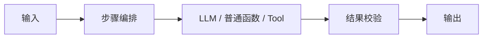
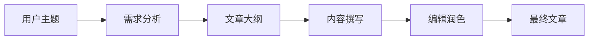
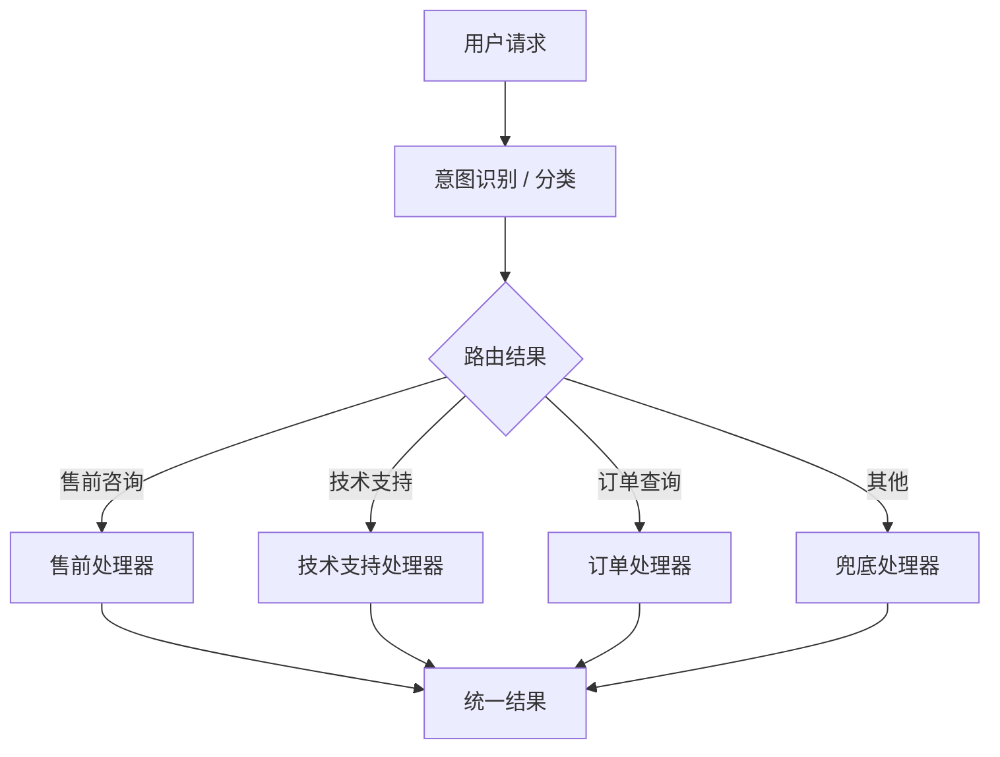
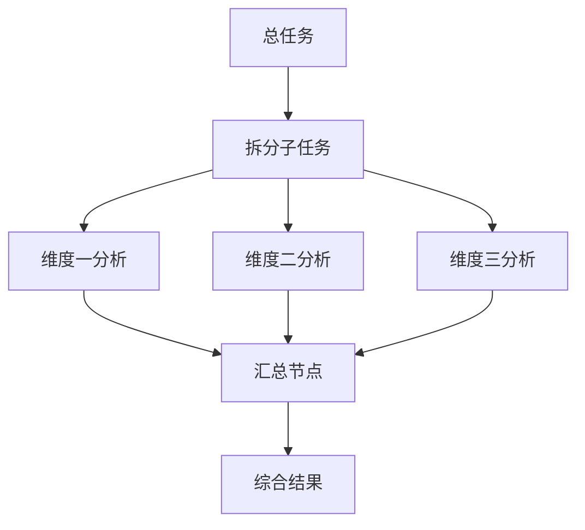
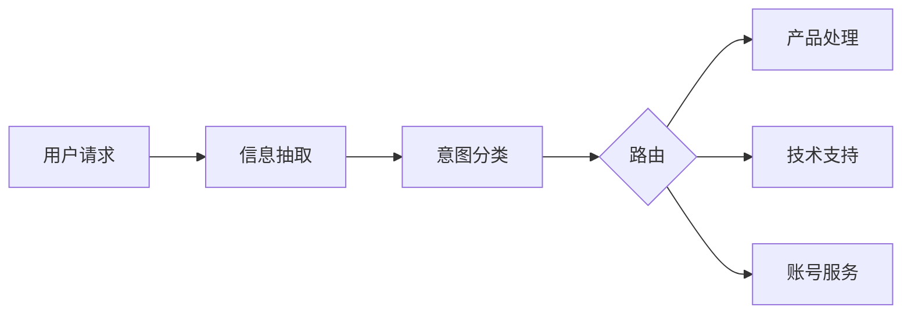
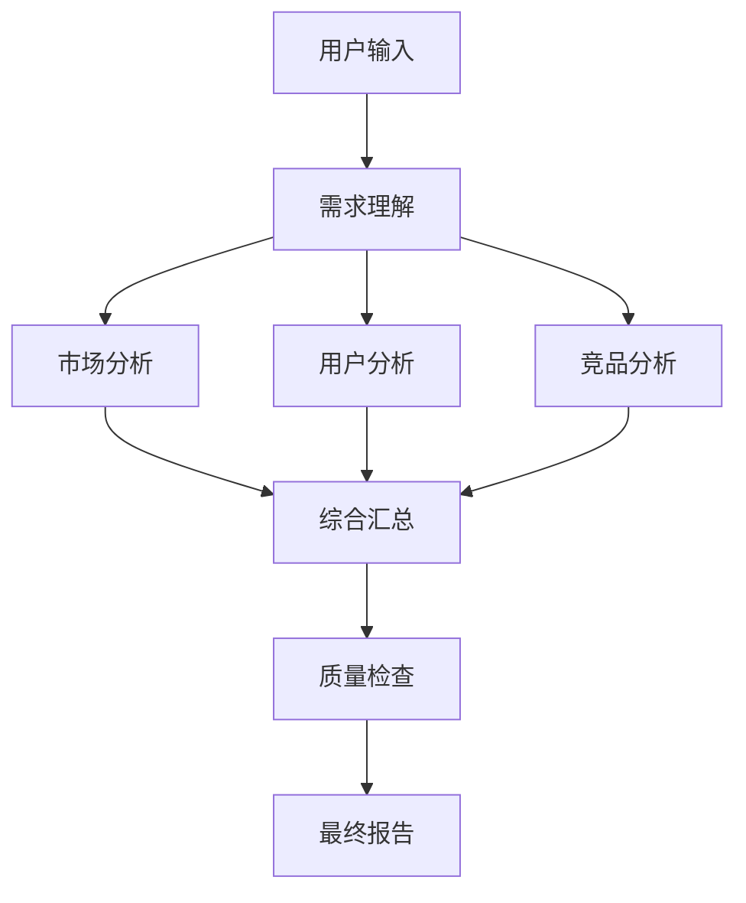

# 第2章 基础工作流设计模式

> 本章目标：掌握 Prompt Chaining、Routing、Parallelization 三种基础工作流模式，理解其执行机制、适用边界与组合方式，并使用 Python 和 DeepSeek API 构建可运行示例。

## 2.1 为什么从 Workflow 模式开始

Agent 系统不一定从一个自主循环开始。很多企业任务具有相对稳定的处理步骤：输入数据、分析内容、分类路由、并行收集信息、汇总输出。此时，先用 Workflow 将步骤显式化，往往比直接交给 Agent 更容易控制。

Workflow 的核心特征是**流程由应用程序定义**。LLM 可以参与某个节点的内容生成、分类或判断，但节点之间的连接关系、错误处理和关键业务规则由程序控制。

典型结构：



### 2.1.1 Workflow 的基本组成

- **Node（节点）**：一个可执行步骤，可以是 Python 函数、LLM 调用或工具。
- **Edge（边）**：节点之间的数据传递关系。
- **State（状态）**：保存流程输入、中间结果和最终结果。
- **Condition（条件）**：决定流程分支，例如根据分类结果选择处理器。
- **Join（汇合）**：等待多个分支完成并合并结果。
- **Error Handling（错误处理）**：处理超时、异常、空结果和重试。

### 2.1.2 三种基础模式概览

| 模式 | 核心问题 | 典型结构 | 适用场景 |
|---|---|---|---|
| Prompt Chaining | 一个复杂任务如何拆成多个连续步骤 | A → B → C | 内容生成、数据抽取与改写 |
| Routing | 不同输入应该交给谁处理 | 输入 → 分类 → 分支 | 智能客服、工单分派 |
| Parallelization | 多个独立任务如何同时执行 | Fan-out → Fan-in | 多维度分析、并行检索 |

---

## 2.2 Prompt Chaining：提示词链式调用

### 2.2.1 定义

Prompt Chaining 是将一个复杂任务拆分为多个顺序执行的 LLM 步骤。前一个步骤的输出成为后一个步骤的输入，每一步只负责相对明确的子任务。

它解决的不是“模型能不能一次生成长答案”，而是**如何通过步骤拆分提升过程可控性和输出质量**。

### 2.2.2 执行原理

例如生成一篇产品分析文章，可以拆为：

1. 需求理解：提取主题、目标读者和文章目标。
2. 大纲生成：根据需求生成文章结构。
3. 内容撰写：按大纲完成初稿。
4. 编辑润色：检查逻辑、语气和完整性。



### 2.2.3 关键设计点

**步骤边界**：每一步要有明确输入和输出。不要把所有事情都写进一个超长 Prompt。

**中间结果结构化**：尽量让中间步骤返回 JSON 或固定字段，例如 `topic`、`audience`、`outline`。结构化结果更容易检查和传递。

**质量检查**：下游步骤不应盲目信任上游结果。可以检查必填字段、内容长度、引用来源和格式。

**上下文控制**：只传递下一步需要的信息，避免把所有历史消息都不断累积到 Prompt。

**失败处理**：如果某一步失败，可以重试当前节点，不必从头执行整个链条。

### 2.2.4 优点与局限

优点：
- 流程清楚，易于调试和追踪。
- 每个步骤可单独测试和替换。
- 可以在关键步骤插入规则校验。
- 比一次性生成更容易控制复杂输出。

局限：
- 步骤之间存在顺序依赖，整体延迟可能增加。
- 上游错误会传递到下游。
- 多次 LLM 调用会增加成本。
- 链条过长会增加维护负担。

### 2.2.5 Python 实现：AI 文章生成链

示例文件：`examples/chapter02/prompt_chaining.py`。

实现分为三个 LLM 步骤：生成大纲、撰写正文、编辑文章。客户端按课程统一规范初始化：

```python
client = OpenAI(
    api_key=os.getenv("DEEPSEEK_API_KEY"),
    base_url="https://api.deepseek.com/v1"
)
```

代码将每个步骤封装为独立函数，并把前一步结果显式传给下一步。示例不引入复杂框架，重点观察模式本身。

### 2.2.6 企业案例：AI 内容生产助手

业务背景：市场团队需要根据产品资料快速生成面向不同受众的文章。

输入：产品名称、核心卖点、目标读者、文章用途。

Workflow：
1. 分析输入资料，提取产品事实。
2. 生成文章大纲。
3. 根据大纲撰写初稿。
4. 编辑润色，并检查是否遗漏输入中的关键事实。
5. 输出文章及其结构化元数据。

建议将产品事实与创意表达分开保存，避免润色步骤擅自增加未经确认的产品能力。

---

## 2.3 Routing：路由模式

### 2.3.1 定义

Routing 是先识别输入的类型、意图或任务特征，再将请求交给不同处理分支。它解决的是**一个入口如何把不同类型的任务交给最合适的处理器**。



### 2.3.2 路由的核心步骤

1. 定义类别及类别边界。
2. 对输入进行分类。
3. 将分类结果映射到处理器。
4. 执行对应处理器。
5. 统一处理结果和错误。

类别设计应尽量互斥且覆盖常见请求。类别太多会增加分类难度；类别边界模糊会导致路由不稳定。

### 2.3.3 规则路由与 LLM 路由

| 对比维度 | 规则路由 | LLM 路由 |
|---|---|---|
| 判断方式 | 关键词、正则、业务规则 | 模型理解语义并分类 |
| 可预测性 | 高 | 具有一定不确定性 |
| 复杂语义 | 能力有限 | 更适合复杂表达 |
| 延迟与成本 | 低 | 需要模型调用 |
| 适用场景 | 类别简单、规则明确 | 自然语言表达多样 |
| 主要风险 | 规则覆盖不足 | 分类漂移、输出格式错误 |

工程实践中可以组合：先用规则处理明确请求，再用 LLM 处理难以规则化的输入；对低置信度结果进入澄清或兜底分支。

### 2.3.4 路由输出设计

建议路由节点只返回有限类别，例如：

```json
{
  "category": "technical_support",
  "reason": "用户描述了产品运行错误",
  "confidence": 0.91
}
```

路由类别必须由程序映射到已注册的处理器，不能直接执行模型返回的任意函数名或代码。对无法解析的输出，进入兜底分支。

### 2.3.5 Python 实现：智能客服路由

示例文件：`examples/chapter02/routing.py`。

流程：
1. 使用 DeepSeek 将用户请求分类为售前咨询、技术支持、订单查询或其他。
2. 解析模型返回的类别。
3. 通过 Python 字典选择处理器。
4. 返回统一格式的结果。

路由分类与业务处理分开，便于单独测试分类准确率和各处理器逻辑。

### 2.3.6 企业案例：智能客服分流

客户输入：“昨天买的设备今天无法开机，订单号是 A1024。”

路由器需要识别主要意图。若业务规定一个请求只能进入一个处理分支，可优先路由到技术支持，并在处理器中调用订单查询工具补充信息；若允许多意图，则应设计多标签路由并明确执行顺序。

设计注意：
- 订单号等实体可以由独立抽取节点提取。
- 不能因为模型判断为“订单查询”就绕过用户身份验证。
- 处理器失败时应有统一兜底响应。
- 对低置信度分类可以先追问，而不是强行路由。

---

## 2.4 Parallelization：并行化模式

### 2.4.1 定义

Parallelization 是把一个任务拆成多个相互独立或依赖较少的子任务，并行执行后汇总结果。它解决的是**如何缩短多个独立分析步骤的总耗时，或从多个角度同时获得信息**。



### 2.4.2 Fan-out / Fan-in

- **Fan-out**：将任务分发给多个并行分支。
- **Fan-in**：等待分支完成，将结果合并为一个输出。

典型执行结构：

```python
with ThreadPoolExecutor(max_workers=3) as executor:
    futures = [executor.submit(analyze, item) for item in tasks]
    results = [future.result() for future in futures]
summary = summarize(results)
```

### 2.4.3 并行任务拆分原则

适合并行的子任务：
- 输入基本相同，分析角度不同。
- 彼此不需要读取对方的中间结果。
- 可以独立定义输出结构和完成标准。
- 结果可以在汇总阶段合并。

不适合直接并行的任务：
- 后一步必须依赖前一步结果。
- 多个分支会同时修改同一份共享数据。
- 任务之间存在严格顺序或资源互斥。
- 子任务粒度过小，调度开销大于并行收益。

### 2.4.4 并行化的优点与风险

优点：
- 多个独立任务可以同时执行，降低总等待时间。
- 可以从多个维度分析同一主题。
- 子任务相对独立，便于单独扩展和替换。

风险：
- 并发请求可能触发 API 限流。
- 部分分支失败会影响汇总质量。
- 多个分支可能产生冲突或重复结论。
- 并发执行不保证结果顺序。
- 汇总节点可能丢失少数分支的重要信息。

应设计最大并发数、超时、部分失败策略、结果标识和汇总规则。

### 2.4.5 Python 实现：多维度市场分析

示例文件：`examples/chapter02/parallelization.py`。

系统分别分析市场机会、用户需求和竞争格局。三个分析任务独立调用模型，使用线程池并发执行，最后将带有维度标签的结果交给汇总节点。

示例为教学演示，不代表投资建议或真实市场调研结论。真实商业分析应提供可信数据来源，并区分事实、假设和模型推断。

---

## 2.5 三种模式的组合

Workflow 的实际价值通常来自组合，而不是孤立使用某一种模式。

### 2.5.1 Prompt Chaining + Routing

先提取用户请求中的关键信息，再分类并交给对应处理器。

例：企业知识助手先提取产品、版本和问题描述，再路由到产品说明、技术支持或账号服务流程。



### 2.5.2 Routing + Parallelization

先识别任务类型，再在相应分支中并行执行多个独立分析。

例：用户要求分析某个产品的市场表现，路由到市场分析流程；流程同时分析用户需求、竞品和市场趋势，再汇总报告。

### 2.5.3 Sequential + Parallel

一个常见组合是：先进行需求理解，再并行分析多个维度，最后串行汇总和润色。



### 2.5.4 Workflow 与 Agent 的边界

| 需求 | 推荐方案 |
|---|---|
| 步骤明确、顺序固定 | Workflow |
| 需要先分类再进入固定业务流程 | Routing + Workflow |
| 多个独立分析维度 | Parallelization |
| 某个节点需要模型理解或生成 | Workflow 中嵌入 LLM |
| 执行路径需要根据观察动态变化 | 在局部引入 Agent |
| 多个专业角色需要协作 | 进一步评估 Multi-Agent |

不要把每个节点都包装成 Agent。确定性步骤使用普通函数，内容生成或语义判断使用 LLM，动态决策节点才考虑 Agent。

---

## 2.6 工程实践：如何把 Workflow 做得可靠

### 2.6.1 统一输入与输出结构

每个节点最好约定输入、输出字段。例如：

```json
{
  "status": "success",
  "data": {
    "category": "technical_support",
    "summary": "设备无法启动"
  },
  "error": null
}
```

### 2.6.2 日志与可观测性

至少记录：
- workflow_id 和 task_id。
- 节点名称、开始时间和结束时间。
- 输入摘要和输出摘要。
- 模型名称、Token 使用量和耗时。
- 错误类型、重试次数和最终状态。

不要在日志中直接记录 API Key、密码或不必要的个人敏感信息。

### 2.6.3 超时、重试和降级

- 对网络调用设置超时。
- 对短暂性错误采用有限次数重试。
- 对格式错误可以尝试重新生成或进入人工处理。
- 对并行分支允许部分成功时，应明确汇总策略。
- 对关键业务操作应保证幂等性，避免重试造成重复写入。

### 2.6.4 测试策略

- 单元测试：验证每个处理函数。
- 节点测试：验证 Prompt 与模型输出解析。
- 流程测试：验证节点顺序、路由和汇总。
- 异常测试：验证超时、空结果和错误分支。
- 质量评估：用一组固定样例评估分类准确率、内容质量和成本。

---

## 2.7 本章小结

1. Prompt Chaining 通过多个连续步骤处理复杂任务，重点是清晰的步骤边界和中间结果质量。
2. Routing 先分类再分发任务，关键是类别定义、路由输出约束和兜底机制。
3. Parallelization 将独立任务并发执行，再通过 Fan-in 汇总，重点是任务独立性、并发控制和部分失败处理。
4. 三种模式可以组合成更完整的企业工作流。
5. Workflow 中可以嵌入 LLM，也可以在局部节点引入 Agent，但不要把所有节点都设计成 Agent。
6. 企业级 Workflow 必须考虑状态、日志、超时、重试、权限和测试。

## 本章交付物

- Prompt Chaining：AI 文章生成链。
- Routing：智能客服意图路由。
- Parallelization：多维度市场分析。
- Workflow 组合案例：串行分析、并行分析与汇总。
- 章节练习与参考答案。

## 延伸阅读

- [Anthropic — Building Effective Agents](https://www.anthropic.com/research/building-effective-agents)：工作流与 Agent 的适用边界。
- [OpenAI — Function calling guide](https://platform.openai.com/docs/guides/function-calling)：理解结构化工具调用与应用控制边界。
- [LangGraph Documentation](https://docs.langchain.com/oss/python/langgraph/overview)：状态图、节点、条件边与并行编排。
- [Python concurrent.futures](https://docs.python.org/3/library/concurrent.futures.html)：Python 并发执行接口。

> 教学说明：本章代码使用 OpenAI Python SDK 的兼容客户端调用 DeepSeek。模型输出具有不确定性，实际部署时应补充结构化输出校验、超时、重试、权限控制和日志监控。
