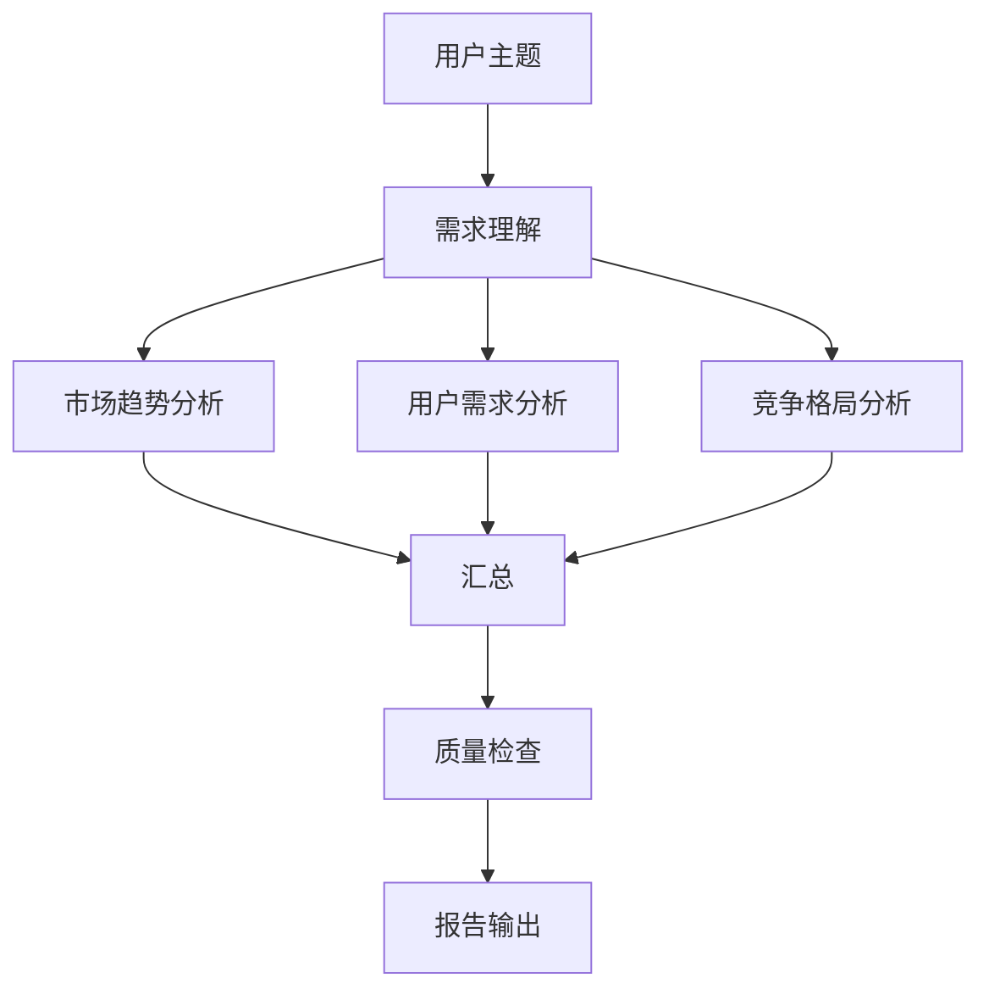

# 第2章练习：基础工作流设计模式

## 练习目标

能够解释并实现 Prompt Chaining、Routing、Parallelization，能够把三种模式组合为可维护的业务 Workflow。

## 练习一：模式辨析

为下列场景选择 Prompt Chaining、Routing、Parallelization 或组合模式，并说明原因。

1. 将会议纪要依次转换为行动项、责任人清单和项目周报。
2. 将客服问题分配给售前、技术支持或订单处理团队。
3. 同时从市场、用户和竞争对手三个角度分析一个产品。
4. 先识别用户需求，再并行分析技术可行性、预算和风险，最后形成建议。
5. 根据上一步生成的大纲撰写文章，再由编辑节点检查事实和表达。

### 参考答案

1. Prompt Chaining：输出之间有明确顺序依赖。
2. Routing：根据意图选择不同处理器。
3. Parallelization：分析维度相互独立，最后汇总。
4. Prompt Chaining + Parallelization：先理解需求，再并行分析，最后汇总。
5. Prompt Chaining：前一步输出成为后一步输入。

## 练习二：Prompt Chaining 设计

业务背景：公司需要根据产品资料生成一篇面向企业客户的产品介绍文章。

请设计至少三个节点，写出每个节点的输入、输出和 Prompt 目标，并说明如何防止上游错误传递到下游。

### 参考思路

- 节点一：事实提取，输出产品名称、功能、适用人群、限制条件。
- 节点二：文章大纲，输入事实清单，输出标题和章节结构。
- 节点三：正文生成，严格依据事实和大纲写作。
- 节点四：事实核验与润色，删除无依据的夸大描述。
- 在节点间校验必填字段，并保留来源资料。

## 练习三：Routing 实现

扩展 `examples/chapter02/routing.py`：

1. 增加“售后退换货”类别。
2. 增加对应处理器。
3. 修改分类 Prompt 和路由映射。
4. 准备至少 10 条测试输入，计算每个类别的分类准确率。

### 参考思路

类别需要明确边界，例如“退款、退货、换货”归入售后；“订单什么时候发货”归入订单查询。测试集应覆盖边界模糊和多意图输入。

## 练习四：Parallelization 设计

扩展 `examples/chapter02/parallelization.py`：

1. 增加“技术可行性”分析维度。
2. 将最大并发数改为可配置参数。
3. 为每个分支记录耗时。
4. 思考某个分支失败时，系统应该整体失败还是保留部分结果。

### 参考思路

- 使用 `time.perf_counter()` 记录分支耗时。
- 并发数根据 API 限额和任务规模设置，不应无限增加。
- 对非关键分支可以保留部分成功结果，并在汇总中明确缺失维度。
- 对关键分支失败则应停止汇总或转入降级流程。

## 练习五：综合案例——企业市场研究助手

需求：用户输入一个产品或行业主题，系统先理解需求，再并行分析市场趋势、用户需求和竞争格局，最后生成综合报告。

提交内容：

1. Workflow 流程图。
2. 节点职责与输入输出定义。
3. 并行分支设计和汇总规则。
4. 失败处理和超时策略。
5. 至少 5 条测试用例。

### 参考架构



## 代码运行任务

在仓库根目录安装依赖：

```bash
pip install -r requirements.txt
```

设置环境变量 `DEEPSEEK_API_KEY` 后运行：

```bash
python examples/chapter02/prompt_chaining.py
python examples/chapter02/routing.py
python examples/chapter02/parallelization.py
python examples/chapter02/workflow_composition.py
```

所有调用 DeepSeek 的示例统一使用：

```python
client = OpenAI(
    api_key=os.getenv("DEEPSEEK_API_KEY"),
    base_url="https://api.deepseek.com/v1"
)
```

## 完成标准

- 能解释三种模式的执行结构和适用场景。
- 能独立实现链式调用、意图路由和并行汇总。
- 能处理路由兜底、并发限制和部分失败。
- 能把三种模式组合成完整 Workflow。
- 能运行本章四个示例，并说明每个节点的输入输出。
